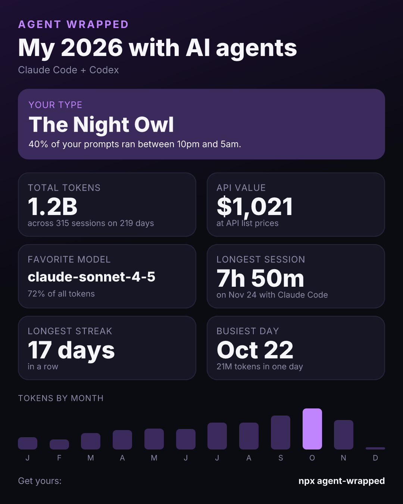

# agent-wrapped

**Your year with AI coding agents, wrapped.** One command. One shareable card. 100% local.

```bash
npx agent-wrapped
```

<p align="center">
  
</p>

<sub>The card above is made from demo data (`scripts/make-demo-home.ts`).</sub>

## What you get

- **A card to share** (`agent-wrapped-2026.png`, 1080×1350): total tokens, API value, favorite model, longest session, longest streak, busiest day, your coding type and a month-by-month chart.
- **A summary in your terminal**, with a breakdown per agent and per model.
- **Raw numbers as JSON** with `--json`, if you want to build your own thing.

## Supported agents

| Agent | Status | Reads from |
| --- | --- | --- |
| Claude Code | Supported | `~/.claude/projects`, `~/.config/claude/projects`, `CLAUDE_CONFIG_DIR` |
| Codex CLI | Supported | `~/.codex/sessions`, `~/.codex/archived_sessions`, `CODEX_HOME` |
| Cursor, Gemini CLI, others | Wanted | [Add one](docs/ADDING_AN_AGENT.md): it is a single folder |

## 100% local

- The tool reads log files on your machine and writes one image. That is all.
- It has **no network code**. A test fails the build if anyone adds some (`test/no-network.test.ts`).
- It never reads your prompts or your code. The internal data type has no field for them.
- Project names are hashed before they leave the log reader. They are only used to count projects.

## Options

```text
-y, --year <year>        year to wrap (default: this year)
-a, --agent <agent...>   only these agents: claude-code, codex
-o, --output <path>      where to save the image
    --json               print the raw report as JSON instead
    --no-image           do not write an image
    --time-zone <iana>   time zone for days and hours (default: your system's)
```

## About the numbers

- **API value** is what your tokens would cost at public API list prices. If you are on a subscription, you paid less. Prices come from a snapshot bundled with the package (source: [LiteLLM's price list](https://github.com/BerriAI/litellm/blob/main/model_prices_and_context_window.json)); models without a known price are listed and left out of the cost.
- **Sessions** are the agents' own sessions. A session's length is the time between its first and last model call.
- Agents delete old logs. Claude Code removes sessions after 30 days by default (`cleanupPeriodDays` in its settings), so your wrapped can only cover what is still on disk.

## How it works

```text
discover -> parse -> normalize -> price -> aggregate -> insights -> render
\___ adapters ___/  \______________ core (pure) ______________/  \ renderers /
```

Each agent has an adapter that turns its logs into one shared event format. The core only knows that format. See [docs/ARCHITECTURE.md](docs/ARCHITECTURE.md).

## Contributing

New agents and new cards are very welcome. Start with [CONTRIBUTING.md](CONTRIBUTING.md).

## License

MIT
