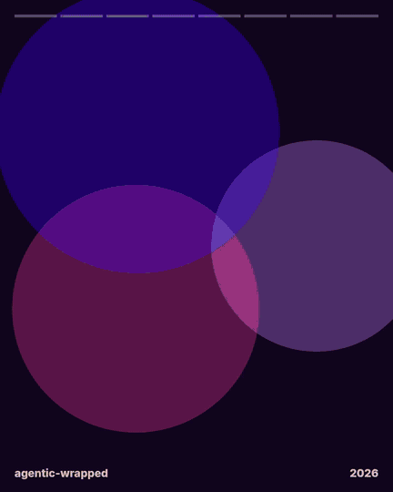

# agentic-wrapped

**Your year with AI coding agents, wrapped.** One command. A 20-second video and a card to share. 100% local.

```bash
npx agentic-wrapped
```

<p align="center">
  <a href="https://github.com/shippedbymax/agentic-wrapped/raw/main/docs/demo.mp4">
    
  </a>
  <br>
  <sub>Made from demo data. The real clip has a beat: <a href="https://github.com/shippedbymax/agentic-wrapped/raw/main/docs/demo.mp4">watch it with sound</a>.</sub>
</p>

## What you get

- **A 20-second video with a beat** (`agentic-wrapped-2026.html`): open it in your browser, press play, press **Save video** and you get an MP4 to post (Chrome and Safari; Firefox saves WebM). It is one self-contained file: no server, no external files.
- **A card to share** (`agentic-wrapped-2026.png`, 1080×1350): total tokens, API value, favorite model, longest session, longest streak, busiest day, your coding type and a month-by-month chart.
- **A summary in your terminal**, with a breakdown per agent and per model.
- **A text to post**, with your numbers and `#AgenticWrapped`, printed in the terminal and next to the video.
- **Raw numbers as JSON** with `--json`, if you want to build your own thing.

## Supported agents

| Agent | Status | Reads from |
| --- | --- | --- |
| Claude Code | Supported | `~/.claude/projects`, `~/.config/claude/projects`, `CLAUDE_CONFIG_DIR` |
| Codex CLI | Supported | `~/.codex/sessions`, `~/.codex/archived_sessions`, `CODEX_HOME` |
| Cursor, Gemini CLI, others | Wanted | [Add one](docs/ADDING_AN_AGENT.md): it is a single folder |

## 100% local

- The tool reads log files on your machine and writes two files: an image and a video page. That is all.
- The video page is self-contained. The animation and the music are generated in your browser; nothing is loaded from the internet. It has one link, to this repository, which only opens when you click it.
- It has **no network code**. A test fails the build if anyone adds some (`test/no-network.test.ts`).
- It never reads your prompts or your code. The internal data type has no field for them.
- Project names are hashed before they leave the log reader. They are only used to count projects.

## No logs on your machine?

The tool only sees agents that run on this computer and keep logs here: Claude Code and Codex CLI today. To see what you would get, run the labeled sample:

```bash
npx agentic-wrapped --demo
```

Using Cursor, Gemini CLI or another agent? [Ask for it or add it](https://github.com/shippedbymax/agentic-wrapped/issues).

## Options

```text
-y, --year <year>        year to wrap (default: this year)
-a, --agent <agent...>   only these agents: claude-code, codex
-o, --output <path>      where to save the image (the video goes next to it)
    --demo               show a sample with made-up numbers
    --json               print the raw report as JSON instead
    --no-image           do not write an image
    --no-video           do not write the video page
    --time-zone <iana>   time zone for days and hours (default: your system's)
```

## About the numbers

- **API value** is what your tokens would cost at public API list prices. If you are on a subscription, you paid less. Prices come from a snapshot bundled with the package (source: [LiteLLM's price list](https://github.com/BerriAI/litellm/blob/main/model_prices_and_context_window.json)); models without a known price are listed and left out of the cost.
- **Sessions** are the agents' own sessions. A session's length is the time between its first and last model call.
- **Agents delete old logs.** Claude Code removes sessions after 30 days by default, so your wrapped can only cover what is still on disk. When there are only a few weeks of data, the video and the card say so ("My 30 days") instead of pretending it is your year. To keep more from now on, set `"cleanupPeriodDays": 365` in `~/.claude/settings.json`.

## Known limits

- **Early version.** The log readers are tested against sample logs that follow the documented formats. Real-world logs have more variety; please [open an issue](https://github.com/shippedbymax/agentic-wrapped/issues) with the (anonymized) line that broke.
- **Resumed or forked Codex sessions** can replay earlier usage into a new log file. Such usage may be counted twice.
- **Memory.** Log files are read as a stream, but all usage events of the year are held in memory to remove duplicates. Very heavy users may need a few hundred MB.

## How it works

```text
discover -> parse -> normalize -> price -> aggregate -> insights -> render
\___ adapters ___/  \______________ core (pure) ______________/  \ renderers /
```

Each agent has an adapter that turns its logs into one shared event format. The core only knows that format. See [docs/ARCHITECTURE.md](docs/ARCHITECTURE.md).

## Contributing

New agents and new cards are very welcome. Start with [CONTRIBUTING.md](CONTRIBUTING.md).

## License

MIT

---

Built by [shippedbymax](https://github.com/shippedbymax). Follow the build on [X](https://x.com/shippedbymax).
